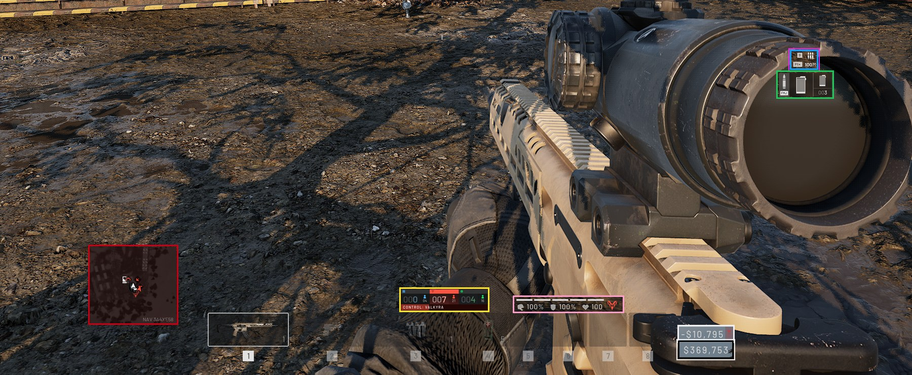
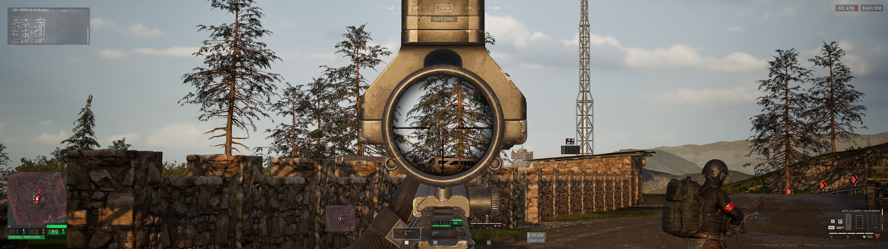
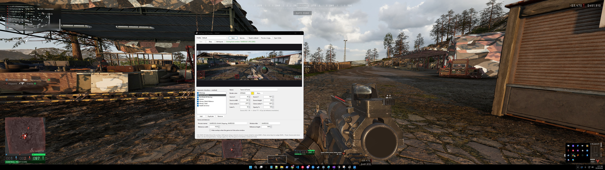

# WarDogs HUD Overlay

**A free tool for super-ultrawide (32:9) players.** It copies the HUD pieces that WARDOGS pins to the
far corners of the screen (minimap, team score, ammo, fire mode, health, money) and shows a live copy
of each one near the center, where you can actually see it without turning your head.

*The colored borders mark each piece for this preview. In game the copies have no borders.*

---

## ⚠️ Read this first

**This is an unofficial fan project. It is not made, approved or endorsed by BULKHEAD or Team17.**

**Use it at your own risk.** WARDOGS' [EULA](https://www.wardogs.com/eula) prohibits using
"unauthorised third-party software in connection with the Services," and the game's anti-cheat
monitors running applications. As of this writing, BULKHEAD hasn't said whether a passive, display-only
overlay like this counts. **I can't promise it won't get you flagged or banned.** Until there's an
official answer or an in-game option for ultrawide HUDs, the safest choice is to only use it in the
firing range.

I made this because there's no ultrawide HUD option in the game yet. I'm asking BULKHEAD about it and
will update this page when they respond. If they say it isn't allowed, I'll take it down.

**It's also vibe coded.** I'm not a professional developer. I built this with an AI assistant (Claude),
tested it on my own PC, and I'm sharing it as-is. It's small and all the code is here, so please read it
or ask someone you trust to look it over before running it.

---

## What it does and doesn't do

It uses **DWM thumbnails**, the same Windows feature that draws the live window previews when you hover
over the taskbar or press Alt+Tab. Windows itself renders the copied pixels. The app only tells it which
rectangle to copy and where to draw it.

| ✅ Does | ❌ Doesn't |
|---|---|
| Show a live, resized copy of parts of what's already on your screen | Read or write game memory |
| Sit on top of the game in small click-through windows | Inject code or DLLs into the game |
| Save layouts as plain JSON files on your PC | Modify game files |
| | Send keyboard or mouse input to the game |
| | Show anything the game isn't already showing you |
| | Connect to the internet |

It uses very little CPU, GPU or memory (around 20–35 MB of RAM).

---

## Requirements

- Windows 10 or 11
- WARDOGS running in **borderless windowed** mode. Exclusive fullscreen blocks every overlay, including
  Discord and Steam.
- The default layout is made for **5120×1440**. Other resolutions are scaled automatically, but you may
  want to fine-tune the positions.

## Install

**Option A: download the exe**
1. Go to **Releases** on the right side of this page and download `WarDogsOverlay.exe`.
2. Run it. Windows SmartScreen may warn you because the exe isn't code-signed (signing costs money).
   Click **More info → Run anyway**, or build it yourself with Option B if you'd rather not.
3. If it asks for the .NET Desktop Runtime, install it from Microsoft and run the app again.

**Option B: build it yourself**
1. Install the .NET 10 SDK: `winget install Microsoft.DotNet.SDK.10`
2. Download this repo (**Code → Download ZIP**) and extract it.
3. Double-click `build.bat`. The exe ends up in the `publish` folder.

You can also open `WarDogsOverlay.csproj` in Visual Studio and press F5.

## How to use

1. Start WARDOGS in borderless windowed mode.
2. Open WarDogsOverlay and click **Start**. The status line turns green once it finds the game.
3. Switch to the game. The copies appear near the center.
4. **Ctrl+Shift+W** hides or shows them, for example in menus.

## Adjusting the layout

Click **Edit layout**, and each copy gets a colored frame (the selected one turns white). Then you can:
- **drag** a copy to move it
- use the **mouse wheel** to resize it (hold Shift for small steps)
- use the **arrow keys** to nudge it 1 px (hold Shift for 10 px)

The fields under the preview change the selected piece live: what area to copy (source X/Y/width/height),
where to put the copy (center X/Y), size (scale %) and opacity.

- **Add / Duplicate / Remove** manage pieces. The checkbox turns a piece on or off.
- **Save** keeps your changes. **Save as…** makes a new profile, so you can keep several layouts.
- **Reset to default** brings back the built-in layout.
- **Hide overlays when the game isn't the active window** (under *Game and behavior*) hides the copies
  when you alt-tab out.

Profiles are saved in `%AppData%\WarDogsOverlay\profiles\` as JSON. **Open folder** takes you there, and
you can share your layout by sharing that file.

## Default layout (5120×1440)

| Piece | Copied from (x, y, w, h) | Copy centered at | Size |
|---|---|---|---|
| Minimap | 42, 993, 343, 303 | 1963, 1262 | 50% |
| Teams & Points | 42, 1301, 342, 84 | 2577, 1291 | 50% |
| Health & Armor | 4783, 1341, 305, 42 | 2822, 1300 | 70% |
| Fire Mode & Zeroing | 4762, 1264, 100, 68 | 3287, 818 | 50% |
| Ammo | 4863, 1233, 216, 100 | 3289, 867 | 50% |
| Money: Match Balance | 4800, 26, 143, 40 | 3093, 1359 | 75% |
| Money: Total | 4954, 26, 139, 40 | 3093, 1390 | 75% |

## Troubleshooting

- **Stuck on "Waiting for the game…"**: Open Task Manager → **Details**, find the WARDOGS process,
  and type its name (without `.exe`) into **Process names**.
- **Copies are black or frozen**: The game is probably in exclusive fullscreen. Switch to borderless
  windowed.
- **Copies are in the wrong place**: Check your resolution. If it isn't 5120×1440, adjust the layout
  in Edit layout mode.
- **Copies disappear when I click away**: Untick **Hide overlays when the game isn't the active window**.

## How the code is organized

| File | What it does |
|---|---|
| `Native.cs` | Windows API declarations (DWM thumbnails, window styles, hotkey) |
| `SegmentOverlay.cs` | One small click-through window showing one copied piece |
| `OverlayManager.cs` | Finds the game, creates the copies, keeps them positioned, hides/shows them |
| `Profile.cs` | Layout settings and saving/loading the JSON profiles |
| `MainForm.cs` | The control panel |
| `profiles/default.json` | The built-in layout |

## Screenshots

## License

MIT. Do whatever you want with it, but there's no warranty. See [LICENSE](LICENSE).
